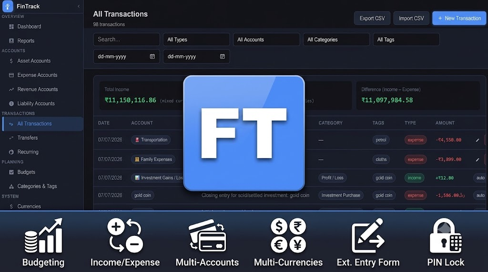

  

<h1 align="center">FinTrack</h1>

<b>A full-featured personal finance manager, built as a Nextcloud app.</b>

  
  
  

Track accounts, income and expenses, transfers, budgets, and recurring
transactions — with full multi-currency support — all stored in your own
Nextcloud database. No subscriptions, no ads. (The only data sent off your
server is a small usage ping and optional exchange-rate lookups — see
[Data & privacy](#data--privacy).)

---

## Table of contents

- [Features](#features)
- [Screenshots](#screenshots)
- [Installation](#installation)
- [Getting started](#getting-started)
- [Feature guide](#feature-guide)
  - [Accounts](#accounts)
  - [Transactions](#transactions)
  - [Transfers](#transfers)
  - [Recurring transactions](#recurring-transactions)
  - [Budgets](#budgets)
  - [Categories & tags](#categories--tags)
  - [Multi-currency](#multi-currency)
  - [Dashboard & reports](#dashboard--reports)
  - [CSV import / export](#csv-import--export)
  - [External entry form & API](#external-entry-form--api)
  - [Progressive Web App (PWA)](#progressive-web-app-pwa)
  - [Pin Lock](#pin-lock)
  - [Settings, backup & reset](#settings-backup--reset)
- [REST API](#rest-api)
- [Data & privacy](#data--privacy)
- [Requirements](#requirements)
- [Contributing](#contributing)
- [Support](#support)
- [License](#license)

---

## Features

- 🏦 **Asset, Liability, and Expense accounts** — track bank/cash balances alongside spending-category buckets
- 💸 **Income & expense transactions** with categories, tags, notes, and multi-currency amounts
- 🔁 **Inter-account transfers** with automatic currency conversion and fuzzy account search
- ⏱ **Recurring transactions** (daily / weekly / monthly / yearly), posted automatically in the background
- 📊 **Budgets** with per-category progress tracking
- 🏷 **Categories and tags**, with rule-based auto-categorization on CSV import, rename cascading to every past transaction, and deletion blocked once either is in use
- 🌍 **Multi-currency support**, with per-transaction exchange-rate snapshots so past transactions never silently re-price when a rate changes later, and a choice of rate provider **per currency** — Automatic (try [Frankfurter](https://api.frankfurter.dev) first, fall back to [exchangerate.host](https://exchangerate.host)), Frankfurter only, or exchangerate.host only
- 📈 **Dashboard & reports** — spending by category, monthly trends, asset allocation, upcoming recurring items due in the next 5 days
- 📥 **CSV / JSON import & export**, with automatic duplicate detection and a preview table before you commit
- 📲 **Installable Progressive Web App** — a full offline-capable app (not just a quick-entry form) that signs in via Nextcloud's own Login Flow v2, works on desktop and mobile, and optionally unlocks with Face/Touch ID or your device's screen lock instead of retyping your PIN every time
- 🔐 **Remote PWA session management** — every browser/device that's logged into the PWA is listed in Settings, with a one-tap Revoke that logs it out and wipes its local cached data on next sync; inactive PWA installs can also auto-wipe themselves after a configurable number of days
- 🔒 **Optional app-local PIN lock**, layered on top of your Nextcloud login, with session timeout, lockout after repeated failures, and an admin-assisted reset flow if you forget it — required (and centrally enforced) for the PWA
- 💾 **Automatic backup to Nextcloud Files** before any full data reset
- 🗄 **All data stored in your own Nextcloud database** — nothing leaves your server except the app version (sent to track app installations) and optional exchange-rate lookups; see [Data & privacy](#data--privacy)

## Screenshots

  

## Installation

1. Open **Nextcloud → Apps → Tools**, search for **FinTrack**, and click **Download and enable**.
   - Or install manually: download the latest release from the [GitHub repo](https://github.com/cloudsliberty/fintrack), extract it into your Nextcloud `apps/` directory as `apps/fintrack`, then enable it under **Settings → Apps**.
2. Requires **Nextcloud 32+**.
3. Open FinTrack from the Nextcloud app menu.

## Getting started

1. **Add an account** — go to *Accounts*, choose a type (Asset, Liability, or Expense) and currency.
2. **Set your base currency** — *Settings → Currencies* — this is the currency all cross-account totals are shown in.
3. **Add a transaction** — *Transactions → Add* — pick an account, amount, category, and (optionally) tags and notes.
4. Optional next steps: set up a [budget](#budgets), a [recurring transaction](#recurring-transactions), the [external entry form](#external-entry-form--api) for quick mobile entry, or a [Pin Lock](#pin-lock) PIN.

## Feature guide

### Accounts

Four account types, each serving a different purpose:

| Type | Use for |
|---|---|
| **Asset** | Bank accounts, cash, savings, investments — anything you own |
| **Liability** | Credit cards, loans — anything you owe |
| **Revenue** | Income-source buckets (e.g. "Salary", "Freelance") for income-tracking without a real linked account |
| **Expense** | Spending-category buckets (e.g. "Groceries", "Rent") for expense-tracking without a real linked account |

Each account has its own currency, icon, and color, and can be archived
(marked inactive) without deleting its transaction history. Deleting an
account outright is only allowed once it has no linked transactions or
transfers — otherwise it's automatically marked inactive instead, with an
explanation why. Clicking an account tile jumps straight to Transactions
filtered to just that account.

### Transactions

Income or expense entries against an account: amount, description,
category, tags (free-text, autosuggested from previously used tags),
notes, and date. Foreign-currency accounts can carry a per-transaction
**conversion rate**, frozen at entry time, so editing your currency table
later never silently re-prices historical transactions. Entering a rate on a
transaction (or a per-row rate in a CSV import) affects only that
transaction; the stored rate on the Currencies page changes only when you
edit it there. A transaction without a currency (external form, quick-add
URL) uses its account's currency.

### Transfers

Move money between two accounts in one step. If the accounts use
different currencies, FinTrack converts the amount automatically (with an
editable rate) and records both legs. Account pickers support fuzzy
search for people with many accounts.

### Recurring transactions

Set up a transaction template with a frequency (daily / weekly / monthly
/ yearly) and FinTrack posts it automatically on schedule in the
background — no need to open the app on the due date. The Dashboard
surfaces everything due in the next 5 days so nothing is a surprise, and
you can post an occurrence manually early if needed. Overdue rules catch up
one occurrence at a time, each booked on its scheduled date, and month-end
rules keep their day (a rule on the 31st posts Feb 28, then Mar 31). A rule
that keeps failing is retried with a growing delay (15 min up to 24 h)
instead of every run.

**Alerts (1.22.0+).** Each recurring transaction sends a Nextcloud alert
(notification bell) on its exact trigger date. Turn it on or off per rule
from the rule's details (Edit Recurring Transaction → *Nextcloud alert*).
Alerts are on by default, including for existing rules. Alert text reads
`FinTrack: <description> (<amount>)`.

### Transaction reminders

Any transaction can carry an optional **Reminder date**. On that day
FinTrack sends you a Nextcloud alert — handy for tracking when lent or
borrowed money is due back, an upcoming bill, or a recharge. Changing the
date re-arms the reminder; clearing it or deleting the transaction removes
it. Alerts are raised by FinTrack's background job, so Nextcloud cron
should be running (it already is required for automatic recurring posts).

### Budgets

Set a spending limit per category (or overall) for a monthly or custom
period, in any currency, and track progress with a live progress bar as
transactions come in.

### Categories & tags

Categories are typed (income / expense / transfer) and carry an icon and
color. Tags are free-text and shared across all your transactions with
autosuggest. Categories can be exported/imported as a set, or generated
from a sensible built-in default list (Groceries, Rent/Mortgage,
Entertainment, etc.) with one click. Renaming a category or tag updates
every past transaction and recurring rule that uses it; deleting one is
blocked while it's still in use, so you rename instead of losing the
link to your history. Clicking a category card or tag chip jumps
straight to Transactions filtered to just that item.

### Multi-currency

Add any number of currencies with a code, symbol, and exchange rate
relative to your base currency. Rates can be entered manually or fetched
online. Each currency has its own rate-provider setting on the
Currencies page: **Automatic** (try [Frankfurter](https://api.frankfurter.dev)
first — free, no API key — then fall back to
[exchangerate.host](https://exchangerate.host) for pairs Frankfurter
doesn't cover, such as SAR or AED), **Frankfurter only**, or
**exchangerate.host only** (requires a free API key, set in *Settings →
Currency Rate API Key*; capped at 100 lookups on its free tier — a
purchased plan removes that cap). Every transaction, transfer, and total
correctly distinguishes between "priced in this account's currency" and
"converted to your base currency for reporting" — and conversions always
prefer a transaction's own frozen rate over today's live rate, so past
totals stay stable. The last successfully fetched online rate for each
currency pair is cached with a timestamp and used to auto-fill the
Conversion Rate field (with a "Last updated: ..." label) the next time
you add a transaction or transfer in that pair, in both the Nextcloud
app and the PWA. The base currency itself is edited from Settings in
the Nextcloud app and shown with a badge next to its entry on the Currencies
page (including in the PWA, which doesn't allow editing it directly).
Deleting a currency is blocked once it's used by any account or
transaction.

### Dashboard & reports

- Account balances and net worth at a glance
- Income vs. expense trends over time
- Spending broken down by category
- Asset allocation across accounts
- Upcoming recurring transactions due soon
- Filterable transaction reports by account, category, type, and date range

### CSV import / export

Export all transactions to CSV or a full JSON backup. Import a CSV with a
downloadable template as a starting point; FinTrack shows a **column
mapping summary** (which file header matched which field) and a **preview
table** before anything is committed, with duplicate, update, and invalid
rows clearly flagged. Optional rule-based auto-categorization fills in a
category from the description when the file doesn't specify one. Every
row that fails validation is reported individually — row number, the
column that failed, and why — in an Import Results dialog after the
import runs, instead of just a pass/fail count.

Re-importing a file you've exported **updates** matching transactions
instead of duplicating them: each transaction carries a permanent
`unique-key(for-updating)` — simply its own row id — included
automatically in every export. Leave that column blank on a row to create
a new transaction instead.

### External entry form & API

*Settings → External Access - PWA* gives you an API token for scripts,
automations, or your own client. Authenticated by a single token rather
than a Nextcloud session — see [REST API](#rest-api) below for the full
request/response format. The token is masked in Settings and requires
your Pin Lock PIN to reveal or copy, if one is set.

### Progressive Web App (PWA)

FinTrack ships an installable, offline-capable Progressive Web App —
the full app, not just a quick-entry form — at `/apps/fintrack/pwa`. The
same link (labeled **PWA URL**) is shown, as a plain clickable link with
a Copy button, in *Settings → External Access - PWA* in the Nextcloud app.

- **Sign-in** uses Nextcloud's own Login Flow v2 (no separate password to
  manage), then talks to the same internal REST API the Nextcloud app uses.
- **PIN Lock is mandatory for the PWA.** Turning PWA access on without a
  PIN set prompts you to create one first; disabling Pin Lock from the
  Nextcloud app turns PWA access off too, since there'd be nothing to
  protect the offline-cached data with otherwise.
- **Biometric unlock** (Face/Touch ID, Windows Hello, or your device's
  screen lock) can be enabled after your first PIN entry, or later from
  PWA Settings. It works every time you reopen the app, not just within
  the same tab session — the PIN it unlocks is kept encrypted at rest on
  the device behind the biometric prompt. It's a device-presence gate
  layered on top of your PIN, not a hardware-secured replacement for it,
  since the PIN itself remains the actual local-encryption key.
- **Fuzzy-search combo pickers** for Account, Category, and Tags (with
  removable chips) on Transactions, Recurring, and Transfers, matching
  the Nextcloud app. Tapping an account tile, category, or tag jumps
  straight to Transactions pre-filtered to it. New Transaction, New
  Transfer, New Recurring Rule, and New Budget never pre-select an
  account/currency for you — you always choose explicitly.
- **Reminders & alerts.** The transaction form has a Reminder date, and
  recurring rules have a Nextcloud-alert switch, same as the Nextcloud app.
- **Live currency conversion** on the New Transaction and Transfer forms
  when the account's currency differs from your base currency — a
  Conversion Rate field auto-fills from the last rate fetched for that
  pair (with a "Last updated: ..." timestamp) and can be refreshed with
  a one-tap online fetch or overridden manually, same as the Nextcloud app.
- **Offline mode.** Creating a new transaction is the one action that
  still works with no connection — it's queued locally (encrypted) and
  uploaded automatically once you're back online, checked at every app
  open, and available on demand from *Settings → Offline Pending Sync*.
  Before each queued entry uploads, it's checked against your existing
  transactions by date and amount; a likely duplicate prompts you to
  confirm or discard that entry before it syncs. Every other action
  (adding/editing accounts, transfers, recurring rules, budgets,
  categories, tags, currencies, or editing an existing transaction)
  needs a connection.
- **Responsive layout** — a fixed bottom navigation bar on mobile,
  centered content with sensible max-widths on desktop.
- **Remote session management.** Every device/browser that's logged into
  the PWA gets its own session ID, listed in *Settings → External Access
  - PWA* in the Nextcloud app with a **Revoke** button — revoking logs
  that device out and wipes its locally cached data the next time it
  syncs. You can also set how many days a PWA install may sit unused
  before it wipes itself automatically (*Settings → PWA data retention*).

### Pin Lock

An optional PIN layered on top of your normal Nextcloud login — useful on
a shared device or if your Nextcloud session stays logged in. Includes an
auto-lock timeout after inactivity, lockout after repeated failed
attempts, a self-service security-question reset, and an
admin-approval reset flow for when both the PIN and the security answer
are forgotten.

Once a PIN is set, choose exactly which actions require it under
**Protected Actions**: exporting transactions to CSV, importing
transactions from CSV, viewing Recently Deleted, and/or the Progressive
Web App.

### Settings, backup & reset

Deleting an account or transaction
always asks for confirmation first — account deletion adds a 5-second
cancellable countdown on top, since it can't be undone. Deleted
transactions aren't gone immediately either: the last 100 land in
**Recently Deleted** (a recycle bin) and can be restored any time, or
purged for good. A full backup is written to Nextcloud Files automatically
before any full data reset, and settings can be restored from a previous
backup.

## REST API

FinTrack exposes two API surfaces:

- **`/api/*`** — the full internal API (accounts, transactions, transfers,
  budgets, categories, currencies, recurring rules, settings, summary).
  Authenticated by your live Nextcloud session; this is what the web UI
  itself uses.
- **`/external/*`** — a smaller, public, **token-authenticated** API
  (`X-FinTrack-Token` header) for quick transaction entry from outside
  Nextcloud — no session or cookies required. Get your token from
  *Settings → External Access*.

Full endpoint list, request/response shapes, and integration examples
(including a ready-to-use spec for building your own client) are in the
[admin manual](docs/MANUAL.md).

## Data & privacy

All of your financial data — accounts, transactions, budgets, categories and
settings — lives in your own Nextcloud database and is never sent to the
developer or any third party.

**Usage ping (telemetry).** The Nextcloud app sends ping data to the developer.
Each ping contains exactly:

- a timestamp,
- a random **install ID** generated once for your FinTrack install (not derived
  from your Nextcloud instance ID, username, or any personal data),
- your **Nextcloud version**,
- your **FinTrack version**, and
- your **country** (if you choose to share it).

No name, email, account identifiers, or financial data of any kind is
included.

**Exchange rates.** The only other external calls are to Frankfurter and/or
exchangerate.host for live exchange rates, and only if you use online rate
lookups.

**PWA local storage.** The PWA caches a copy of your data locally in the
browser's IndexedDB, encrypted with a key derived from your PIN, so it works
offline; nothing in that cache is sent anywhere except back to your own
Nextcloud server. If you enable biometric unlock, your PIN is stored in
IndexedDB on that device, encrypted with a random per-device key that is also
kept in IndexedDB (the PIN is **not** kept in `sessionStorage`). This persists
across browser restarts, is only released after the Face/Touch ID or
screen-lock prompt, and is removed when you disable biometric unlock or log
out. Because the key lives on the same device, it is a device-presence gate,
not protection against someone with full access to the browser's storage.
Revoking a PWA session or letting one sit unused past its retention window
wipes that device's local cache. Transactions created offline are queued
locally (also encrypted) until the device is back online, then uploaded to
your own Nextcloud server.

**Backups.** Backup files (including the automatic pre-reset backup in
Nextcloud Files) contain the External Access token, PIN hashes, and the
exchangerate.host API key, stored encrypted with your Nextcloud server's key
(so they can only be opened on the same server). Restoring a backup keeps your
PIN, token and API key; the backup only fills in any that are missing, for
example after a reset. The rest of the backup is plain JSON, so keep the
backup data in a secure place.

## Requirements

- Nextcloud **32+**
- PHP as required by your Nextcloud installation
- No additional services required (exchange-rate API is optional)

## Contributing

Issues and pull requests are welcome at
[github.com/cloudsliberty/fintrack](https://github.com/cloudsliberty/fintrack/issues).

## Support

- 🐛 [Report a bug](https://github.com/cloudsliberty/fintrack/issues)
- 📖 [Admin manual](docs/MANUAL.md)
- ☕ [Donate](https://www.paypal.me/jaleel1618) if FinTrack is useful to you

## License

[AGPL-3.0](LICENSE) — © Abdul Jaleel Adenpulan
